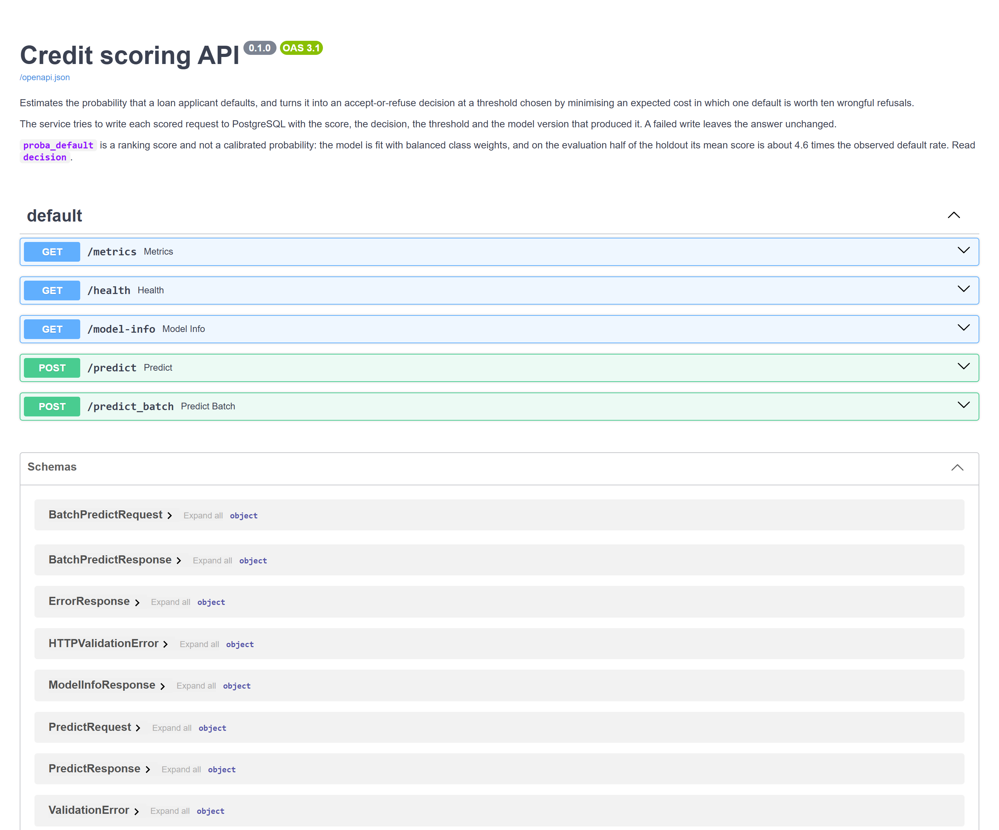
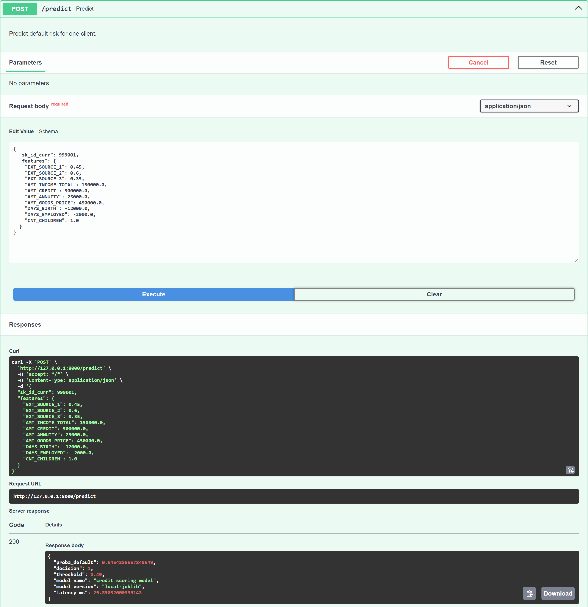
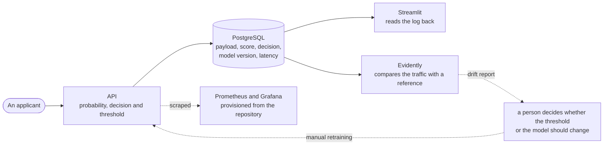
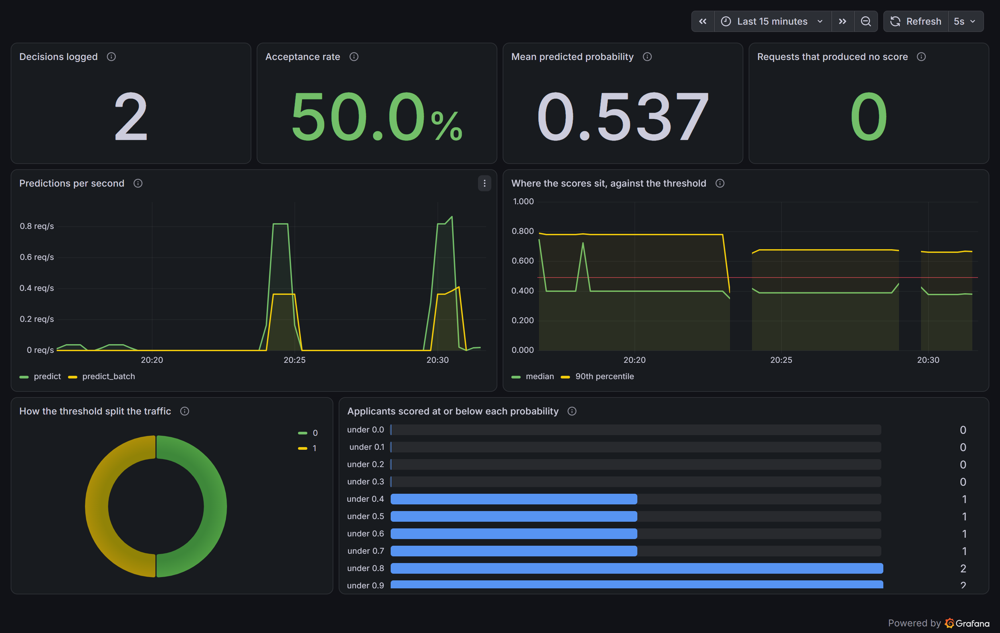
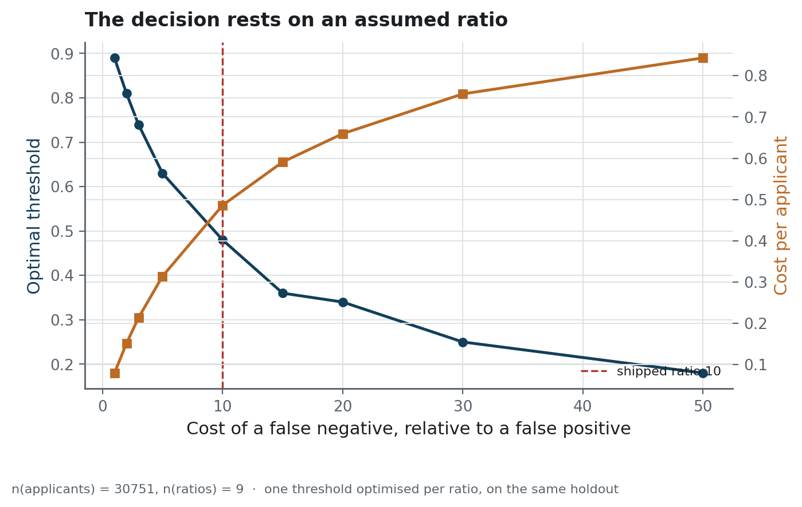
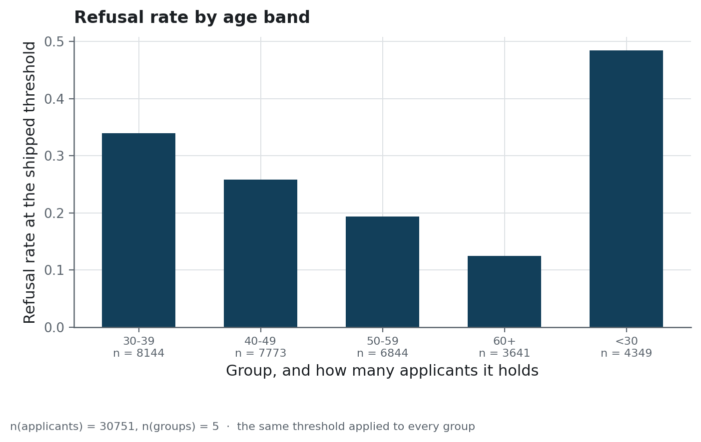
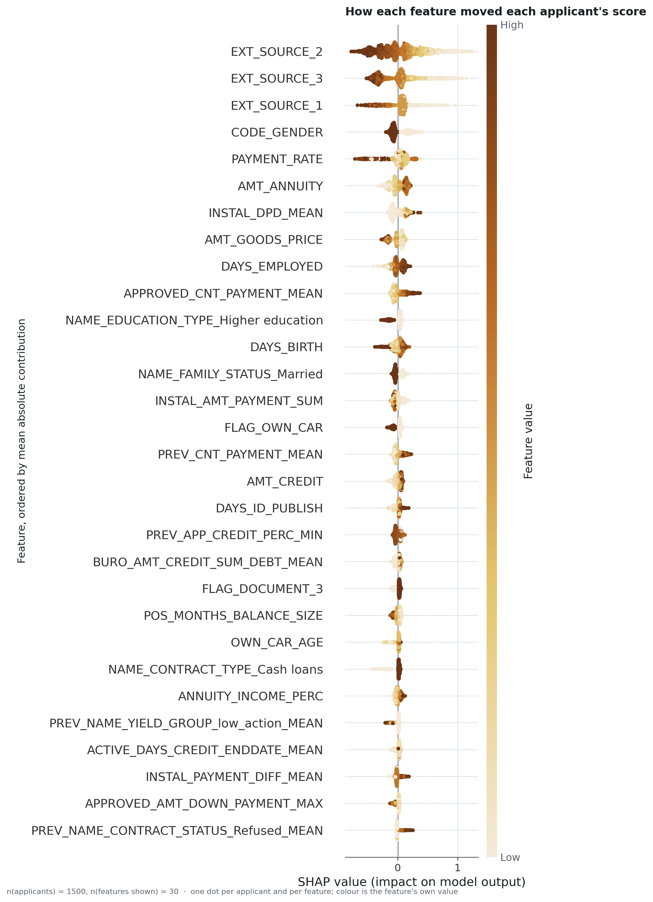
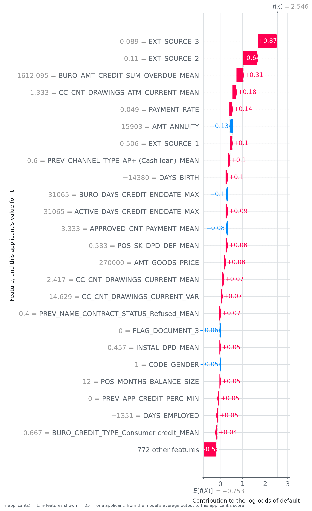
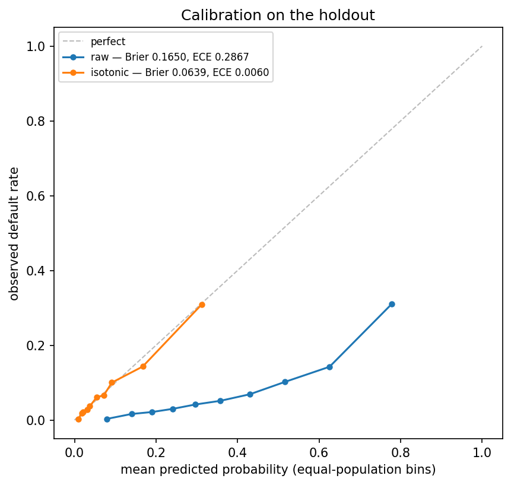
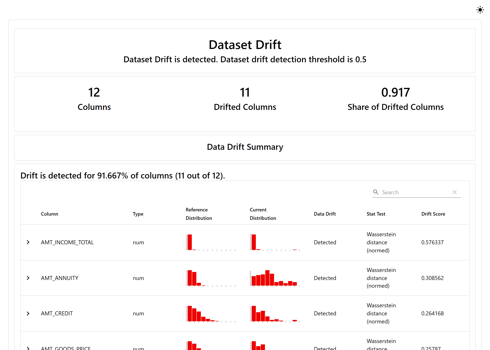

<h1 align="center">Credit scoring</h1>

<p align="center">A default-risk model behind an API, with a refusal threshold chosen to minimise an assumed cost</p>

<p align="center">
  
  
  
  
</p>

<div align="justify">

**Project status** — complete, with no further development planned. The model is served behind
an API that applies a measured accept-or-refuse threshold, and `docker compose up` starts
the API, the interface, PostgreSQL, Prometheus and Grafana on one machine, and the drift report
and the training scripts run from the command line. The Home Credit data is not included,
because the competition rules restrict its redistribution. The CI workflow is started by hand
and does not train a model. It installs the locked environment with **uv**, runs **Ruff** and
the **pytest** suite, and builds the API image. **Bandit** runs as a pre-commit hook.

The scores are not financial advice, and no lending decision should be based on them. The data
comes from a public competition, and the cost ratio behind the threshold is an assumption. A
real credit policy must also satisfy rules that this repository does not model.

## The problem

A lender can make two kinds of mistake, and they have different costs. Refusing an applicant who
would have repaid loses the margin on the loan, while approving one who then defaults loses the
principal. A threshold of 0.5 on a calibrated probability would be the right cut-off only if the
two mistakes cost the same.

The data is [Home Credit Default Risk](https://www.kaggle.com/c/home-credit-default-risk): eight
of its CSV files, forming seven relational tables, which describe loan applications and the
applicants' credit histories. The build joins them into one row per applicant. About 8 % of the
labelled applicants default.

Most of this repository concerns where to put the threshold, and how that choice changes when
the cost assumption behind it changes.

## What it does

An API scores an applicant and returns a probability of default, the decision at the shipped
threshold, and that threshold. The request and response contracts are Pydantic models, and
FastAPI generates the OpenAPI page below from them.

<!-- source: docs/images/MANIFEST.json -->


Each scored request is written to PostgreSQL on a best-effort basis, with its payload, score,
decision, model version and latency. [`docs/DB.md`](docs/DB.md) describes that table and the
columns that may be empty.

<!-- source: docs/images/MANIFEST.json -->


A Streamlit interface sends the same request from a browser page, where the JSON body is
pre-filled and can be edited. Its second page reads the log back and plots it with Plotly: the
recent decisions, their latency, and how the threshold split the traffic.
[`docs/interface.md`](docs/interface.md) describes both pages and gives the equivalent `curl`
calls.

<!-- source: docs/images/MANIFEST.json -->


<!-- source: docs/images/MANIFEST.json -->


Prometheus scrapes the metrics of the API and Grafana displays them. The Grafana data source and
dashboard are provisioned from files under `infra/grafana/`, so the dashboard is defined in the
repository. Evidently compares the logged traffic with a reference sample, in a report generated
on demand by a script that runs outside the containers.



<!-- source: docs/images/MANIFEST.json -->


### How it is built

The model is **LightGBM**, trained on 796 feature columns, one of them the applicant identifier,
that **pandas** builds from the seven tables and stores as **Parquet**. The shipped model is a
**scikit-learn** pipeline that replaces infinities, imputes missing values with the median and
passes the result to the classifier, which weights the two classes to handle their imbalance.
**imbalanced-learn** provides the pipeline of the cross-validated comparison runs, with an
optional undersampling step. **MLflow**
records the training runs, and **Optuna** searched the LightGBM hyper-parameters. **FastAPI**
serves the model under **Uvicorn**, and **SQLAlchemy** maps the **PostgreSQL** table of the
prediction log. **SHAP** explains individual scores. **ONNX** Runtime was benchmarked on the
classifier and kept as an experiment, since profiling puts most of the time in preprocessing.

Three design choices shape the code. First, the imputation, and the scaling used by the linear
and neural models, are steps of the pipeline, fitted inside each training fold.
`credexp.modeling.pipelines` describes the leak this prevents, a common cause of optimistic
published scores on this dataset.

Second, the containers serve a frozen artefact read from `models/` at startup and do not contact
the MLflow registry. `credexp.serving.model_loader` explains why the registry stays out of the
serving path. With `MODEL_LOAD_MODE` unset, the loader runs in `auto` mode and tries the
registry first.

Third, the final training writes `model_manifest.json`, which the loader reads when present. It
records the feature columns and a schema version, the threshold and its selection rule, the
hyper-parameters and their tuning trial, the imbalance strategy, a fingerprint of the training
data and the commit. The hyper-parameters used to be copied by hand. The training now reads them
from the tracked trials and stops if that file is missing. The three files under `models/`
predate the manifest, so the loader uses `threshold.json` and `feature_columns.json` and logs a
warning.

## The result

<!-- source: reports/decision/decision_analysis.json -->
The threshold minimises an expected cost in which one default costs ten times as much as one
wrongly refused applicant. **The shipped value is 0.49.** On the holdout of n = 30 751
applicants, it refuses 28 % of them.

A cost per applicant is only meaningful beside a reference, so the table includes three policies
that use no model:

<!-- source: reports/decision/decision_analysis.json -->
| Policy | n | cost_per_row |
|---|---|---|
| refuse everyone | 30 751 | 0.9193 |
| random at the base rate | 30 751 | 0.8170 |
| accept everyone | 30 751 | 0.8075 |
| **the model, at threshold 0.49** | 30 751 | **0.4888** |

> **How to read it.** Each row applies a decision policy to the same applicants. `cost_per_row`
> is the average loss per applicant under the assumed prices: 1 for an applicant wrongly
> refused, 10 for a default that was accepted, and 0 for a correct decision. Lower is better.
> The first three rows use no model, so the gap between them and the last row measures the
> contribution of the model.

At a ratio of ten to one, refusing everyone is a reasonable policy to compare against, and
`credexp.modeling.baselines` explains why. The model costs 39 % less than the best of the three,
which is to accept everyone.

<!-- source: reports/decision/decision_analysis.json -->
**The interval on that cost runs from 0.4721 to 0.5068**, the central 95 % of n = 1000 bootstrap
resamples of the holdout. The threshold is held fixed while the applicants are resampled, and
`credexp.modeling.sensitivity` explains why it is not re-optimised on each resample.

### Comparison with simpler models

The cost table does not separate two parts of the gain: the value of learning anything at all,
and the value of using trees for it.

<!-- source: reports/model_comparison.csv -->
| model | variant | n | roc_auc_mean | pr_auc_mean | business_cost_per_row |
|---|---|---|---|---|---|
| dummy | most_frequent | 30 751 | 0.5000 | 0.0807 | 0.8075 |
| dummy | stratified | 30 751 | 0.5071 | 0.0821 | 0.8050 |
| lr | | 30 751 | 0.7348 | 0.2238 | 0.5623 |
| **lgbm** | | 30 751 | **0.7433** | **0.2324** | **0.5472** |

> **How to read it.** One row per model, each cross-validated on the same five folds of the
> holdout. ROC AUC, for area under the receiver operating characteristic curve, gives the share
> of pairs of one future defaulter and one applicant who repaid that the model orders correctly,
> and it does not depend on the threshold. PR AUC (area under the precision-recall curve) is more
> informative when few applicants default, because its chance level is the default rate.
> `business_cost_per_row` is the mean over the five folds of the cost on each fold, at the
> threshold chosen on the previous fold.

Learning anything at all saves 0.24 per applicant, the gap between the best dummy model and the
logistic regression. Gradient-boosted trees save a further 0.015, about a sixteenth of that.
Notebook 03 reads the same table and discusses what this ratio means for a feature set of 796
columns, most of them engineered aggregates.

These numbers come from five-fold cross-validation on the holdout, which holds 10 % of the
labelled applicants, against 90 % for the development set of the shipped model. The header of
the script gives that smaller sample as the reason the costs sit above the 0.4888 reported
earlier. The LightGBM row uses the fixed settings of
`credexp.modeling.train`; only the final training uses the tuned hyper-parameters.
`uv run python scripts/compare_models.py` rebuilds the table.

### How the threshold depends on the cost ratio

<!-- source: reports/figures/MANIFEST.json -->


> **How to read it.** The horizontal axis is the assumed cost of a default relative to a wrongly
> refused applicant. The blue line, read on the left axis, is the threshold that minimises the
> expected cost at each ratio. The orange line, read on the right axis, is the cost per applicant
> that this threshold produces. The dashed vertical line marks the ratio this repository uses.
> Between a ratio of 1 and a ratio of 50, the optimal threshold moves across most of the range
> from 0 to 1.

<!-- source: reports/decision/decision_analysis.json -->
The ten-to-one ratio is an assumption made without data on a lender's losses. Over the n = 9
ratios swept, the optimal threshold falls from **0.89** when a default costs as much as a
wrongful refusal to **0.18** when it costs fifty times as much. Between these two ends, the
threshold moves by 0.71 on a scale from 0 to 1.

This figure should be read before the others on this page. Every result above depends on a
ratio that only the party bearing the losses could supply, so each should be quoted as "0.4888
per applicant, given a ratio of ten to one".

### Who it refuses

<!-- source: reports/decision/decision_analysis.json -->
| Group | n | default_rate | refusal_rate | fnr |
|---|---|---|---|---|
| under 30 | 4 349 | 0.1122 | **0.4842** | 0.2111 |
| 30-39 | 8 144 | 0.0933 | 0.3396 | 0.2539 |
| 40-49 | 7 773 | 0.0783 | 0.2579 | 0.3268 |
| 50-59 | 6 844 | 0.0646 | 0.1940 | 0.4570 |
| 60 and over | 3 641 | 0.0505 | **0.1247** | **0.5870** |
| men | 10 371 | 0.1030 | 0.3781 | 0.2425 |
| women | 20 380 | 0.0694 | 0.2325 | 0.3859 |

> **How to read it.** One row per group of applicants. `default_rate` is the observed share of
> the group that defaulted, and the other two columns are read against it. `refusal_rate` is the
> share that the shipped threshold refuses. `fnr` is the false negative rate, the share of the
> group's own defaulters that the threshold accepted. A low refusal rate together with a high
> false negative rate means that a group is accepted more often than its default record supports.

<!-- source: reports/decision/decision_analysis.json -->
Among the n = 4349 applicants under thirty the refusal rate is **0.4842**, and among the
n = 3641 applicants aged sixty and over it is **0.1247**. The default rates of the two groups,
0.1122 and 0.0505, differ by a factor of 2.2, and their refusal rates by a factor of 3.9. A
single threshold can widen a gap in risk, so these two ratios alone do not say how much of the
refusal gap the difference in risk explains. Of the applicants aged sixty and over who
defaulted, the model accepted **0.587**. Both figures follow from the lower scores the model
gives to this group.

<!-- source: reports/figures/MANIFEST.json -->


> **How to read it.** One bar per age band. Its height is the share of the band that the shipped
> threshold refuses, and the population of the band is written underneath. The bands are in age
> order, so the slope across the bars follows age. Every bar stands above the default rate of
> its band in the table above, because in every band the threshold refuses more applicants who
> would have repaid than it accepts applicants who default. The line printed under the figure
> also mentions a 95 % Wilson interval on each rate, which the figure does not draw.

The model is not adjusted for these gaps. Adjusting a credit model for fairness requires
choosing a definition of fairness, and several reasonable definitions conflict: when base rates
differ, equal refusal rates and equal error rates cannot both hold. That choice belongs to
whoever owns the lending policy, so this repository publishes the gaps and leaves them
uncorrected.

`uv run python scripts/decision_analysis.py`, run on the holdout with the shipped model, reproduces
every number in this section and writes
them to `reports/decision/`.

### Which features drive the scores

<!-- source: reports/figures/MANIFEST.json -->


> **How to read it.** One row per feature, ordered by mean absolute contribution to the score.
> Each dot is one applicant. Its horizontal position is how far that feature moved the
> applicant's score, to the right for more risk and to the left for less, and its shade shows
> whether the applicant's own value for the feature was high or low. SHAP (SHapley Additive
> exPlanations) splits a single prediction into one contribution per feature, so a wide row
> belongs to a feature with a large effect on at least some applicants.

Three external credit-bureau scores have the largest contributions. They are followed by
`CODE_GENDER` and by quantities computed from the loan itself, such as the payment rate, the
annuity and the price of the goods.

No single feature dominates the others. On this dataset, one dominant feature is usually the
sign of a leak, since a column that separated defaulters on its own would more likely record
the outcome than predict it.

**`CODE_GENDER` holds the fourth row of this figure.** The model reads the column directly, so
part of the refusal gap between men and women in the table above comes from the column itself,
in addition to any columns correlated with it. The gap is left uncorrected for the reasons given
above, and this figure shows where it enters the score.

A single applicant can be decomposed in the same way:

<!-- source: reports/figures/MANIFEST.json -->


> **How to read it.** A single applicant, one row per feature, with the applicant's own value
> printed beside the feature name. Each bar is the contribution of that feature in log-odds, the
> scale on which the model adds contributions before it turns the total into a probability. Bars
> pointing right raise the risk and bars pointing left lower it. The average output of the model
> plus the sum of all the bars equals this applicant's score in log-odds.

<!-- source: reports/explainability/explainability_meta.json -->
The average output of the model is a log-odds of **-0.753** over the n = 5000 background sample,
and the applicant shown is the highest-risk of the n = 1500 explained. Two bureau scores close to
zero, `EXT_SOURCE_3` at 0.089 and `EXT_SOURCE_2` at 0.11, add 0.87 and 0.64 to the log-odds,
close to half the distance between the average and this applicant's score. A refused applicant
could be given an explanation in this form.

`uv run python scripts/explainability.py` regenerates the three SHAP figures and the importance
figure from the frozen artefact and a feature frame, which is the training matrix when it exists
and the holdout otherwise.

## Why these numbers can be believed

Four properties of these numbers were checked. Two of the checks found a problem: the threshold
optimism, which the tuning objective still contains, and the probability scale.

<!-- source: reports/decision/decision_analysis.json -->
**The threshold used to be tuned and scored on the same data.** Measured on the two halves of the
n = 30751 holdout, that shortcut lowers the measured cost by **0.0029** per applicant, against a
cost close to 0.49. The bias is real and small. The rule in `credexp.modeling.train` removes it
from the family comparison, and the tuning objective in `credexp.modeling.tuning` still selects
and scores the threshold on the same fold.

<!-- source: reports/decision/decision_analysis.json -->
**The shipped threshold was chosen with a model trained on part of the development set, and then
applied to a model refitted on all of it.** On the n = 30751 holdout, whose own optimum is
**0.48**, the shipped **0.49** costs **0.0028** more per applicant. The measured cost of this
compromise is small.

<!-- source: reports/performance/calibration.json -->
**The threshold is stable under resampling.** Reselected on n = 25 resamples of half the holdout,
it has a median of 0.50 and a 95 % interval of **[0.47, 0.544]**, which contains the shipped
value. This check could have failed. An interval running from 0.3 to 0.7 would have shown that
the shipped threshold was one draw among many.

**The returned probability is not a calibrated probability.** Its calibration was measured on
the n = 15 376 applicants of the holdout that were not used to fit the recalibration:

<!-- source: reports/performance/calibration.json -->
| | mean_score | brier | ece |
|---|---|---|---|
| as served | 0.3656 | 0.1650 | **0.2867** |
| after isotonic recalibration | 0.0815 | 0.0639 | **0.0060** |
| the true base rate | 0.0788 | | |
> n = 15 376 applicants, the evaluation half of the holdout; `calibration.json` records the
> size of the whole holdout, 30 751.

> **How to read it.** Each row scores the same applicants in a different way. `mean_score` is
> the average probability returned, and the last row gives the observed default rate to compare
> it with. `brier` is the mean squared difference between a returned probability and the
> outcome, so it rewards good ranking and a correct scale together. `ece` is the expected
> calibration error, the average gap between the predicted and the observed default rate across
> ten bins.

<!-- source: reports/performance/calibration.json -->
On the evaluation half of the n = 30 751 holdout applicants, the model overstates default
risk across the whole range. The mean score is
**0.3656** against a base rate of **0.0788**, which is 4.64 times higher. This follows from
`class_weight="balanced"`, which gives the defaulters more weight during training and shifts the
predicted probabilities upward. The repository keeps the weighting for the ranking it produces.
ROC AUC depends only on the order of the scores, so it does not register the overstatement.

<!-- source: reports/figures/MANIFEST.json -->


> **How to read it.** The applicants are ranked by the probability the model gave them and split
> into ten bins of equal size. The horizontal position of a bin is its mean predicted
> probability, and its height is the share of it that defaulted. On the dashed diagonal the two
> are equal. A curve that stays below the diagonal along its whole length belongs to a model that
> predicts more risk than it observes. The count printed under the figure, 30 751, is the size of
> the whole holdout, while the curves are drawn on its evaluation half.

Isotonic recalibration, fitted on one half of the holdout and measured on the other, removes
almost all of the gap. Shipping it would mean fitting the calibrator during training on the
validation split, recording it in the manifest, and mapping the threshold through the same
monotone function. Under isotonic regression no two applicants change order, though some become
tied. That requires a training run on the full feature
matrix, which is not shipped here. **Until then the field to read is `decision`, and
`proba_default` is a score.** `uv run python scripts/calibration_report.py` reproduces the table
and the figure.

### Where a leak could come from

The per-customer aggregations are the usual source of leaks on this dataset.
[`docs/data-source.md`](docs/data-source.md) describes what the code guarantees: each aggregate
is grouped on one applicant, and none combines several applicants. The build applies no date
filter, so the absence of information from after the application rests on how Home Credit built
the tables.

Two places would need care if the work were extended. The first is a feature built from an
outcome. The build uses `TARGET` only as the label, but a count of previous defaults taken from
the wrong table would carry the outcome while looking like an ordinary count. The second is
preprocessing fitted outside the fold. The pipeline prevents it by construction, as described
above, and it is listed because it is the leak that most often survives a review here.

A regression of this kind would most likely appear as one feature whose importance far exceeds
all the others. No test checks for this sign. In the gain importance figure of
[`docs/protocol.md`](docs/protocol.md), the two largest features, `EXT_SOURCE_3` and
`EXT_SOURCE_2`, are close to each other, and no single feature stands apart.

One column of the feature set should have been excluded. `SK_ID_CURR`, the applicant identifier,
is the first of the 796 columns, and the shipped trees split on it 236 times. In service the
model receives it only when a caller puts `SK_ID_CURR` inside `features`, since the top-level
`sk_id_curr` field goes to the log and is not passed to the model. The column is otherwise
imputed, so the model sees a different value in service from the one it was evaluated on.

### What the tests assert

Besides running the code, the tests check that the published results are consistent:

- the markdown file under `reports/decision/`, which holds three tables, is byte for byte what the
  renderer produces from the JSON file beside it;
- `models/threshold.json` and the analysis give the same shipped threshold;
- every baseline costs more than the model, and the cost interval contains its point estimate;
- a service started with an unreachable database still returns a score from `/predict`, as a
  best-effort prediction log requires;
- a request that names twelve features is scored on all 796 columns in the fitted order, and the
  pipeline refuses a frame whose columns were permuted.

`pytest` collects 209 cases in three tiers: unit, integration, and a system tier that starts
`uvicorn` in its own process and queries it over HTTP. The system tier found that the service
took two minutes to start when PostgreSQL was unreachable.

## Running it

```bash
cp .env.example .env
uv sync --all-groups
docker compose up -d          # API, Streamlit, PostgreSQL, Prometheus, Grafana
```

The API answers on `:8000`, with its documentation at `/docs`. Streamlit answers on `:8501` and
the provisioned dashboard on `:3000`. The dashboard stays empty until a request has been scored,
so send it some traffic:

```bash
uv run python scripts/send_sample_traffic.py --requests 300
```

Drift is measured on the payloads as the request schema validated them, before imputation, and
only on the columns those payloads contain. `credexp.monitoring.drift` explains which changes this
level can detect, and [`docs/operations.md`](docs/operations.md) describes the two frames it
compares.

```bash
uv run python scripts/build_drift_reference.py   # writes var/data/processed/reference.parquet
uv run python scripts/monitoring_drift.py        # writes reports/monitoring/
```

The drift watch covers changes in who is applying. A change in what an engineered column means
is outside its reach. No scheduled job runs the report, which is generated on demand with the
commands above.

<!-- source: docs/images/MANIFEST.json -->


The decision analysis needs the holdout, which is **not versioned**. To rebuild it from the raw
Kaggle tables, run `scripts/build_features.py`, which writes the feature matrix, then
`scripts/train_final.py`, which writes the holdout, replaces `pipeline.joblib` and
`threshold.json` in `models/` with a refitted model and adds `model_manifest.json` beside them,
and finally `scripts/decision_analysis.py`. Nothing checks that the retraining reproduces the
shipped artefacts, so the analysis then describes the retrained model. To reproduce the published
numbers, restore the shipped files with `git checkout -- models/` and delete
`models/model_manifest.json` before running the analysis.

Six documents give more detail. [`architecture`](docs/architecture.md) describes the
boundaries, [`protocol`](docs/protocol.md) how each number was measured, and
[`data-source`](docs/data-source.md) what may be published. [`DB`](docs/DB.md) gives the schema
of the log, [`interface`](docs/interface.md) covers both pages and the `curl` calls behind them,
and [`operations`](docs/operations.md) is the runbook. The seven notebooks under
[`notebooks/`](notebooks/) follow the order in which the work was done: the join, the
exploration, the family comparison, the tuning study, the explanations, the drift watch and the
benchmarks.

## Structure

```
├── models/     the frozen serving artefacts: pipeline, columns, threshold
├── reports/    the published numbers and figures, written by the scripts and the test run
├── src/        the package: data, db, modeling, monitoring, serving, app
├── scripts/    thin entry points that read arguments and call the package
├── infra/      the images, the Grafana and Prometheus provisioning, the Space recipe
├── notebooks/  the work in the order it was done
├── docs/       six documents, the screenshots and the badges
├── tests/      unit, integration, system
└── var/        what a run writes, and the Kaggle download (not versioned)
```

## What this does not prove

**The cost ratio is an assumption.** Ten to one is a judgement about the domain, and no lender's
accounts were used to set it. Every result downstream depends on it, and the sensitivity figure
shows by how much.

**The probability scale is wrong, and the repository says so.** The calibration section above
measures the error. The decision is unaffected, and any use of `proba_default` as a probability
would inherit the error.

**The fairness gaps are published and left uncorrected.** The section on who the model refuses
gives the reason.

**The family comparison runs on the holdout.** It is five-fold cross-validation on the 30 751
holdout applicants, 10 % of the labelled data, which is also the sample of the decision analysis.
The table gives the mean of each metric over the five folds, and a standard deviation for ROC AUC
and PR AUC only. The
gap in ROC AUC between LightGBM and the logistic regression, 0.0085, is smaller than the standard
deviation of either model, 0.0105 and 0.0118, so these files do not show that LightGBM ranks
better on every fold. The absolute costs also differ from those of the shipped model.

**The holdout took part in the tuning.** As written, `scripts/tune_optuna.py` cross-validates on
every labelled row, the holdout included, so the hyper-parameters were selected on folds that
contain it. The shipped model itself was fitted without the holdout.

**The drift monitor has not been tested on real drift.** The traffic it reads is the holdout
replayed through the API, so the comparison sets two samples of the same Home Credit population
against each other. On that traffic, the report in the screenshot above still flags 11 of its 12
columns as drifted. The mechanism runs end to end, and on this setup its flags cannot reflect a
change in who is applying.

## Licence and data

Code under [MIT](LICENSE).

The Home Credit Default Risk data is **not redistributed**. It remains subject to the terms of
the competition and must be downloaded from Kaggle. Nothing under `var/data/` is versioned. Each
figure under `reports/figures/` is written by a script that can be rerun once the raw tables are
in place. The three files under `models/` take 4 MB. They are this repository's own work and
carry no third-party licence.

</div>
