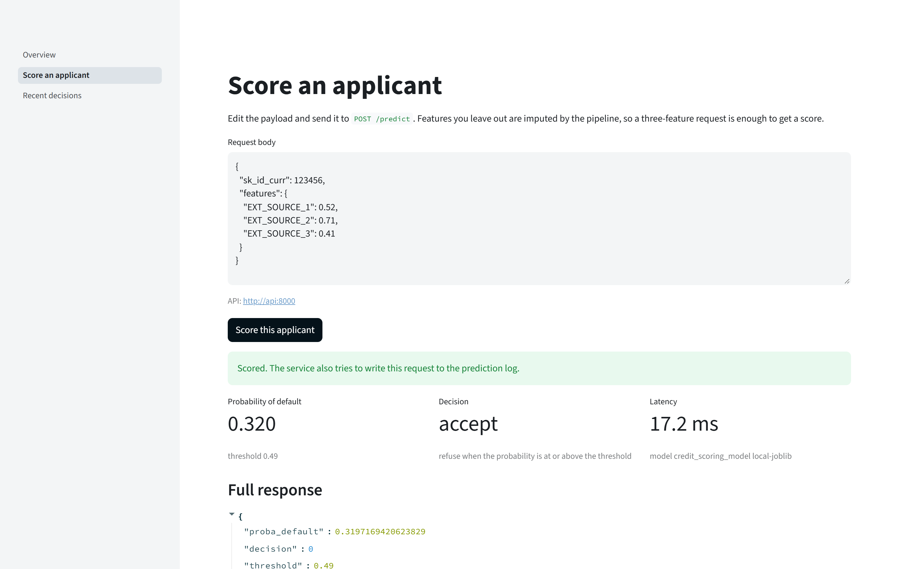
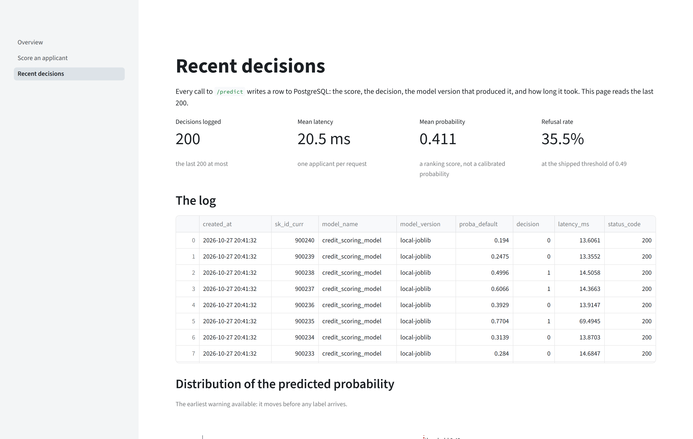

# The two pages, and the API behind them

Besides a landing page, the interface has two pages: a form that scores one applicant, and a
log of the decisions the service has taken. Both are Streamlit pages with no logic of their own,
drawn in the same palette as the figures of the README. `docs/architecture.md` explains where
the boundary between the pages and the package sits. This page describes what the two pages show
and how to query the API without them.

```bash
docker compose up -d                                   # both pages, on :8501
uv run streamlit run src/credexp/app/Overview.py       # or locally, without Docker
```

## Score an applicant

<!-- source: docs/images/MANIFEST.json -->


| On screen | What it is for |
|---|---|
| The request body | a payload to edit; three features are enough, and the pipeline imputes the rest |
| Probability of default | the raw score, which ranks applicants and is not calibrated |
| Decision | the result of applying the threshold to that score: accept, or refuse |
| Latency | the time the API spent building the input and scoring it, in milliseconds |
| The full response | everything the API returned, including the model version |

The page distinguishes three failures, because each calls for a different action from the
reader: a body that is not valid JSON, a request that the service refused with an explanation,
and a service that is not running at the configured address. `credexp.app.service` handles the
three cases, and `tests/unit/app/test_service.py` exercises all of them without a browser.

## Recent decisions

<!-- source: docs/images/MANIFEST.json -->


| Section | The question it answers |
|---|---|
| The four cards | how many decisions, how fast, how risky on average, and what share was refused |
| The log | the rows themselves, most recent first |
| Distribution of the score | where the scores fall, on the full scale from 0 to 1 |
| Latency, request by request | whether the service is slowing down |
| How the threshold split the traffic | the acceptance rate, the figure the business side follows |

The applicants in this screenshot are invented, with identifiers above 900 000, outside the range
of the Home Credit identifiers.

The charts follow three rules, each stated in `credexp.app.charts` and tested in
`tests/unit/app/test_charts.py`. The probability axis is fixed from 0 to 1. The threshold is
drawn on that axis as a dotted line, in the colour the palette reserves for references. The two
outcomes are named in words, so the difference between accepted and refused does not depend on
a colour scale.

## Querying the API directly

FastAPI generates the OpenAPI page at `/docs` from the Pydantic models the service validates
against, so the request and response shapes it shows are the ones the service applies. The calls
below do the same from a terminal.

One applicant:

```bash
curl -s -X POST http://127.0.0.1:8000/predict \
  -H "Content-Type: application/json" \
  -d '{"sk_id_curr": 100002, "features": {"EXT_SOURCE_1": 0.5, "EXT_SOURCE_2": 0.7}}'
```

What the compose stack returns for this payload, with the latency left out because it varies
from one call to the next. The probability and the decision are those that `scripts/smoke.py`
recorded in `reports/serving_smoke.json`, rounded to six decimals, and the model version is the
one the compose file sets:

```json
{"proba_default": 0.389601, "decision": 0, "threshold": 0.49,
 "model_name": "credit_scoring_model", "model_version": "local-joblib", "latency_ms": ...}
```

Several applicants in a single call:

```bash
curl -s -X POST http://127.0.0.1:8000/predict_batch \
  -H "Content-Type: application/json" \
  -d '{"items": [{"features": {"EXT_SOURCE_1": 0.1}}, {"features": {"EXT_SOURCE_1": 0.9}}]}'
```

What is serving:

```bash
curl -s http://127.0.0.1:8000/health       # the process is up
curl -s http://127.0.0.1:8000/model-info   # the loaded model, its threshold and its column count
```

A feature left out of the payload is imputed by the pipeline, so a short request is valid. In a
request to `/predict`, or in an item of a batch, a field other than `sk_id_curr` and `features`
is refused with a 422, and so is an empty `features` map or a value that cannot be read as a
number. `tests/unit/serving/test_schemas.py` explains what accepting a misspelled field would
mean for the applicant being scored. A key inside `features` that names no column of the model
is ignored, so the column the caller meant to send is imputed like any other missing column.

## The theme belongs to the repository

`.streamlit/config.toml` sets the four colours of the pages, and `tests/unit/test_theme.py`
checks that they match the palette of the figures. The comment at the top of the configuration
file describes what the pages look like without it.
