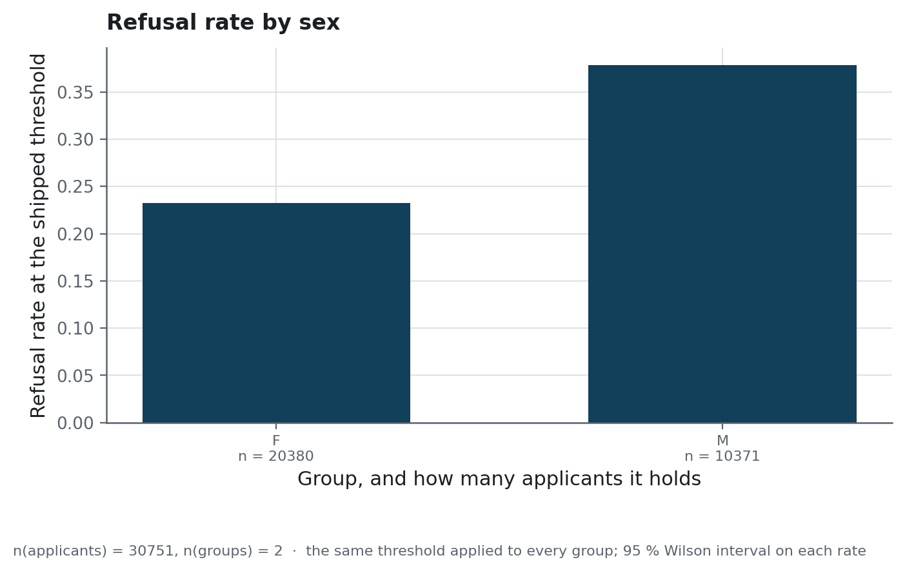

# Running it

How to start the stack, send it traffic, and diagnose a service that stops answering.

## Starting it

```bash
cp .env.example .env
docker compose up -d          # API :8000, Streamlit :8501, PostgreSQL, Prometheus, Grafana :3000
```

This starts five containers. The API and the interface are built from the same Dockerfile,
`infra/api.Dockerfile`. The model consists of the three files under `models/`, which are copied
into the image and loaded once at startup.

Without Docker:

```bash
uv sync --all-groups
uv run python scripts/init_db.py                 # once, against a reachable PostgreSQL
uv run python scripts/run_api.py                 # http://127.0.0.1:8000/docs
uv run streamlit run src/credexp/app/Overview.py # http://127.0.0.1:8501
```

## Configuration

| Variable | Default | What it changes |
|---|---|---|
| `MODEL_LOAD_MODE` | `auto` | `joblib` reads `models/`; `mlflow` and `auto` both try the registry and fall back to `models/` if it fails |
| `MODEL_JOBLIB_PATH` | `models/pipeline.joblib` | the artefact to serve |
| `THRESHOLD_PATH` | `models/threshold.json` | the operating point, when no manifest is present |
| `FEATURE_COLUMNS_PATH` | `models/feature_columns.json` | the column order the pipeline was fitted on, when no manifest is present |
| `DATABASE_URL` | a local PostgreSQL | where the prediction log is written |
| `DB_CONNECT_TIMEOUT` | `3` | the seconds allowed for opening a database connection |
| `API_ROOT_PATH` | empty | the prefix, when the service runs behind a reverse proxy |
| `PROMETHEUS_ENABLED` | `true` | whether `/metrics` is exposed |
| `API_BASE_URL` | `http://127.0.0.1:8000` | where the interface looks for the service |

`.env.example` lists the variables with their purpose, and sets `MODEL_LOAD_MODE` to `joblib`.
One variable is absent from it: `CREDEXP_ROOT`, which overrides the project root that
`credexp.utils.paths` finds.

## The two probes, and which one to wire where

| Route | Answers | A failure means |
|---|---|---|
| `/health` | the process is up; it does not read the model | restart it |
| `/model-info` | which model is loaded, or 503 when none is | stop sending it traffic |

The `HEALTHCHECK` of the container calls `/health`. The service opens its port only after the
startup has loaded the model, so neither route answers while the model is loading, and a model
that fails to load stops the process. The probe allows a start period of thirty seconds.

## Sending traffic, and watching it

```bash
uv run python scripts/send_sample_traffic.py --requests 300
```

The script sends applicants drawn from the holdout: 300 single requests with these options, plus
five batches of twenty by default. The dashboard at `:3000` is provisioned from
`infra/grafana/`. Its data source, panels and queries are files in this repository.

<!-- source: docs/images/MANIFEST.json -->


The four summary panels read counters held by the API process, and a restart sets them back to
zero. In this capture they count two decisions while the rate panel shows a longer replay,
because the API had restarted after most of the replay.

Besides the HTTP metrics that the instrumentator adds, `/metrics` exposes four metrics of its
own:

| Metric | What it counts |
|---|---|
| `credexp_predictions_total` | scored applicants, one per row of a batch, by model version and endpoint |
| `credexp_default_probability` | the distribution of the returned scores |
| `credexp_threshold_crossings_total` | decisions, by side of the threshold |
| `credexp_prediction_failures_total` | requests that produced no score, by kind of failure |

## Watching the traffic itself

```bash
uv run python scripts/build_drift_reference.py   # var/data/processed/reference.parquet
uv run python scripts/monitoring_drift.py        # reports/monitoring/
```

The comparison uses two frames. The first command writes a fixed sample of 20 000 rows of the
feature matrix, or of the holdout when the matrix has not been rebuilt. The second command
rebuilds the current frame from the payloads of the most recent successful requests in the log,
and keeps only the columns that appear in both frames, which are the columns the callers sent.
`credexp.monitoring.drift` explains which changes a comparison at this level can detect.

## What the decisions look like by group

The README publishes the age bands and the two sexes in one table. The figure for the sexes is
on this page because it describes what the shipped threshold does to two populations: applied to
two groups with different default rates, the same threshold refuses them at different rates.
`credexp.modeling.decision_report` computes it offline, on the holdout.

<!-- source: reports/figures/MANIFEST.json -->


> **How to read it.** Each of the two bars gives the share of its group that the shipped
> threshold refuses, with the size of the group printed below it. Each bar can be compared with
> the default rate of the same group in the fairness table of the README. Both bars are higher
> than that rate, since in both groups the applicants refused despite being able to repay
> outnumber the defaulters who were accepted. The text stamped beneath the chart refers to a
> 95 % Wilson interval for each rate, but no interval is drawn.

## When something stops answering

| Symptom | What it is | What to do |
|---|---|---|
| The API container exits at startup | `pipeline.joblib` was not found, or `feature_columns.json` was missing and no parquet file gave the column order | check `MODEL_LOAD_MODE` and that `models/` reached the image |
| `/model-info` reports the fallback threshold, 0.5 by default | `threshold.json` was not found, and the loader fell back to `DEFAULT_THRESHOLD` and logged `threshold_file_missing` | check `THRESHOLD_PATH` and that `models/` reached the image |
| Every prediction returns 200 but the log is empty | the database is unreachable | the log is best effort; check `DATABASE_URL`, then `docker compose logs db` |
| The service takes seconds to start | the database is unreachable and the connection is waiting for its deadline | expected: `DB_CONNECT_TIMEOUT` limits the wait to three seconds |
| A prediction returns 422 | an unexpected field in a `/predict` request or in a batch item, no feature at all, or a non-numeric feature value | the response names the field; the request schema sets `extra="forbid"` |
| The dashboard is empty | nothing has been scored yet | run `scripts/send_sample_traffic.py` |
| `monitoring_drift.py` stops with "No production prediction logs found" | the log holds no successful request | send traffic first |

## Deploying it as a Hugging Face Space

`infra/huggingface/` holds the files for a single-container deployment: the Dockerfile, the
nginx configuration that serves the interface and the API behind one port, the start script and
[the Space card](../infra/huggingface/README.md). A Docker Space builds the Dockerfile at its
root and reads the card from its root `README.md`. To deploy, push this repository to a new
Space with those two files moved to its root. Setting `DATABASE_URL` as a secret of the Space
sends the decisions to a managed PostgreSQL, and without it the service runs and the log stays
empty. The start script launches the interface from `src/credexp/app/Overview.py`, and
`tests/unit/test_space_recipe.py` checks that every Python file it names exists.
