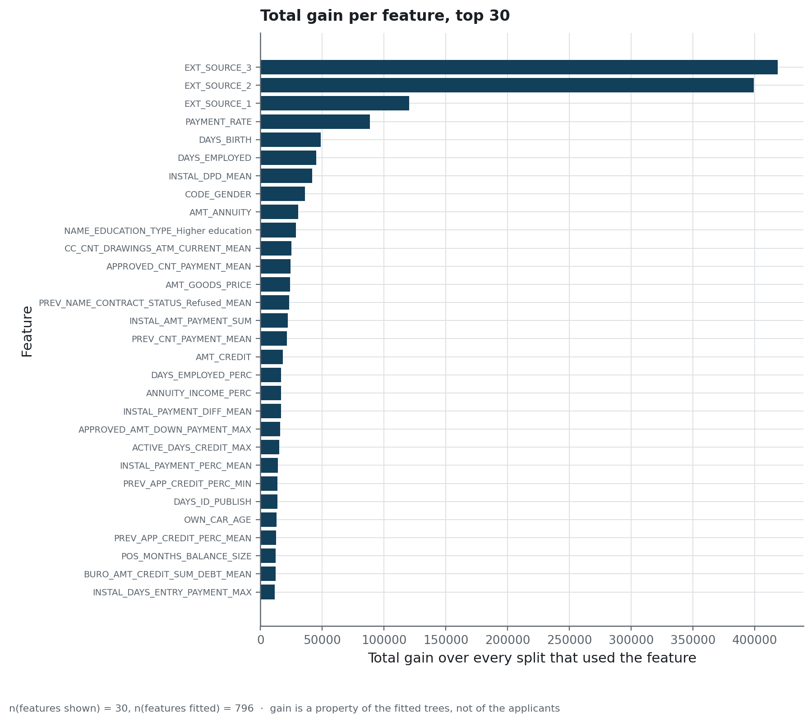
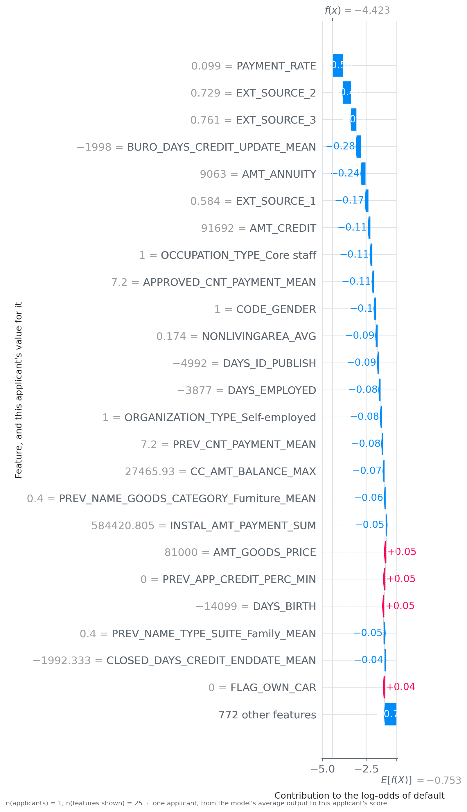

# How each number was measured

`metrics.yaml` defines every metric column of the published tables. This page describes the
protocol behind those tables: which applicants, which split, and what each number can be read
as claiming.

## The three populations

<!-- source: docs/data-source.md -->
| Frame | n | What it is | Where it lives |
|---|---|---|---|
| development set | 276 756 | what the shipped model was fitted on | not in this repository |
| holdout | 30 751 | left out when the shipped model was fitted, and used for every published table | `var/data/processed/api_holdout.parquet` |
| unlabelled | 48 744 | the Kaggle test split, which carries no target | not used here |

`scripts/train_final.py` makes the split once, by row, stratified on the target, after the build
has dropped four labelled rows. The tables on this page and in the README are measured on the
holdout. The tuning study is the exception: as written, `scripts/tune_optuna.py`
cross-validates on every labelled row, holdout included.

## What is held fixed, and what varies

| Held fixed | Varied, and measured |
|---|---|
| The 796 columns, in the order `models/feature_columns.json` records | the **model family**, in `reports/model_comparison.csv` |
| The cost ratio of ten to one | the **assumed ratio**, in the sensitivity sweep |
| The holdout | the **threshold**, reselected on resamples |
| The random seeds: 42 for the holdout and validation splits, the cross-validation folds and LightGBM (the Optuna sampler and the stratified dummy are not seeded); 0 for the bootstrap, the threshold resamples, the random baseline and the two half-splits of the holdout | the **resample**, for every published interval |

## The cost, and why it is the objective

One wrongly refused applicant costs 1, and one missed default costs 10. Each published cost
averages that quantity over the applicants scored. The unit is not money, because no lender's
losses were measured to set it, and `reports/figures/cost_sensitivity.png` shows what changes
when the assumption moves. Every result on this page should be read with the condition "given
ten to one".

## How the threshold is chosen

1. `scripts/tune_optuna.py` runs an Optuna study on LightGBM with the cost as its objective, by
   default thirty trials of three-fold cross-validation. It writes the trials to
   `reports/tuning/optuna_trials.csv` and logs that file to MLflow. The tracked version of the
   file holds ten completed trials.
2. `scripts/train_final.py` reads the best completed trial **from that tracked file**. It fits the
   model on 80 % of the development set, chooses the threshold that minimises the cost on the
   remaining 20 %, and then refits the model on the whole development set.
3. The chosen value, the two costs it rests on and the selection rule go to
   `models/threshold.json` and to the manifest.
4. `scripts/decision_analysis.py` measures everything again on the holdout and writes the tables
   the README publishes.

**In the family comparison, each fold is scored at a threshold chosen on another fold.**
`credexp.modeling.train` applies the threshold chosen on one fold to the next. The shortcut this
rule replaced is published as `optimism`, 0.0029 per applicant, measured on the two halves of the
holdout. The tuning objective in `credexp.modeling.tuning` still picks and scores the threshold on
the same fold.

## Which numbers carry an interval

| Number | Interval | Over what |
|---|---|---|
| cost per applicant | 0.4721 to 0.5068 | 1 000 bootstrap resamples of the holdout, threshold fixed |
| the threshold itself | [0.47, 0.544] | 25 resamples of half the holdout, reselected on each |
| the refusal rate of each group | 95 % Wilson interval | stored in `reports/decision/decision_analysis.json`, shown in no table or figure |
| everything else | none published | the group sizes are in the tables |

The threshold is held fixed while the cost is resampled. Resampling and re-optimising together
would mix two sources of variation in one interval, and its width could not be attributed to
either. The spread of the threshold is measured separately, and the two intervals are meant to
be read together.

## The family comparison

`scripts/compare_models.py` cross-validates four models on five stratified folds of the holdout:
two trivial baselines, a logistic regression, and LightGBM, the family that is shipped. The
LightGBM in this comparison uses the fixed settings of `credexp.modeling.train`, and only the
final training uses the tuned hyper-parameters. The header of the script gives the smaller
training sample as the reason its absolute costs sit above the shipped 0.4888. It also states that the ordering of the families carries
over to the larger sample, and the comparison is meant to establish that ordering.

<!-- source: reports/figures/MANIFEST.json -->

> **How to read it.** One row per column, for the thirty columns with the largest total gain
> among the 796 the model was fitted on. The length of a bar is the total gain, the sum of the
> improvements brought by every split on that column, so the chart describes the fitted model
> and says nothing about any applicant. Two columns that carry the same information share this
> total in an arbitrary proportion, and the chart cannot show how.

The SHAP figures in the README describe the applicants. `scripts/explainability.py` explains a
sample of the labelled training matrix when that matrix has been rebuilt, and a sample of the
holdout otherwise. The lowest-risk applicant of the sample decomposes in the same way as the
highest:

<!-- source: reports/figures/MANIFEST.json -->

> **How to read it.** The same decomposition as in the README, applied here to the safest
> applicant of the sample, where the README shows the riskiest. Bars pointing left are features
> that lowered this applicant's risk, and the sum still holds: the average output plus every bar
> gives the log-odds whose sigmoid the API returns as the score. Side by side, the two figures
> show a small group of columns driving both scores, with opposite signs.

## What a retraining loop would need

The repository has no retraining loop. One would need three components that are missing: an
outcome label that arrives months after the decision, a calibrator fitted during training on the
validation split with the threshold mapped through it, and a drift signal on the engineered
features in addition to the raw payloads. `docs/operations.md` describes what is monitored
today.
